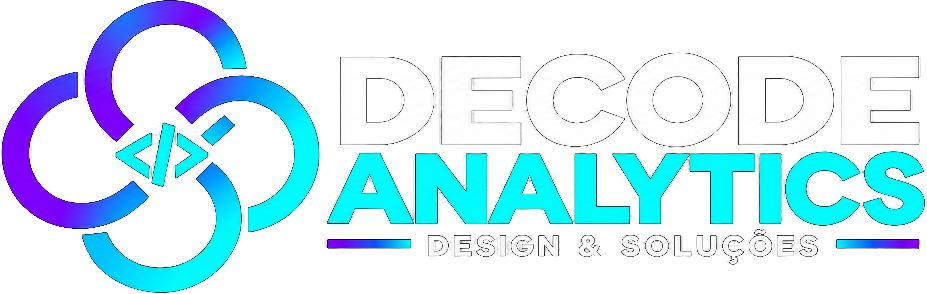

> **Decode Deck — desenvolvido e mantido pela [Decode Analytics](https://www.instagram.com/decode.analytics/).**
> Sede: Presidente Prudente - SP, Brasil | [Hub Oficial](https://kaiqueaurelio.github.io/decode-open-source-hub/)
> Esta edição faz parte da suíte Decode, construída em puro Rust a partir de código aberto.
> Avisos e licenças preservados em [LICENSE-MIT](LICENSE-MIT), [LICENSE-APACHE](LICENSE-APACHE), [NOTICE](NOTICE) e [ATTRIBUTION.md](ATTRIBUTION.md).

<p align="center">
  <a href="https://kaiqueaurelio.github.io/decode-open-source-hub/">
    <picture>
      <source media="(prefers-color-scheme: dark)" srcset="docs/brand/decode-logo-white.svg">
      
    </picture>
  </a>
</p>

<h1 align="center">Decode Deck</h1>

<p align="center">
  <b>Criação de apresentações visuais elegantes, slides dinâmicos e pitch decks.</b>
</p>

<p align="center">
  
  
  <a href="https://www.instagram.com/decode.analytics/"></a>
  <a href="https://kaiqueaurelio.github.io/decode-open-source-hub/"></a>
</p>

---

## Sobre o Aplicativo

O Decode Deck transforma ideias em apresentações impactantes. Possui templates estruturados, transições suaves, gráficos incorporados e modo apresentador para reuniões e palestras.

O **DecodeDeck** foi desenvolvido com foco em desempenho nativo, arquitetura limpa em Rust e segurança de memória. Integrado ao ecossistema [Decode Open Source Hub](https://github.com/Kaiqueaurelio/decode-open-source-hub), o programa pode ser instalado e atualizado de forma centralizada pelo [Decode Launcher](../../launcher/).

## Identidade Visual e Empresa

* **Empresa Mantenedora:** Decode Analytics
* **Localização / Sede:** Presidente Prudente — São Paulo, Brasil
* **Rede Social Oficial:** Instagram [@decode.analytics](https://www.instagram.com/decode.analytics/)
* **E-mail de Contato:** decoanalytics@outlook.com.br
* **Repositório Central:** [Kaiqueaurelio/decode-open-source-hub](https://github.com/Kaiqueaurelio/decode-open-source-hub)

---

## Compilação e Execução Local

Requer o compilador Rust estável instalado (`rustup`):

```bash
# Compilar e executar a aplicação em modo release
cargo run --release -p deckcraft

# Executar a suíte de testes
cargo test --workspace
```

## Instalação pelo Decode Launcher

Para instalar o **Decode Deck** e todos os aplicativos da suíte Decode com instalador gráfico e atualizações automáticas:
1. Abra o [Decode Launcher](../../launcher/).
2. Localize o **DecodeDeck** na grade de aplicativos.
3. Clique em **Instalar** para configurar o binário no seu sistema operacional (Linux, Windows ou macOS).

---

## Licença e Atribuição de Código Aberto

Este software é código aberto licenciado sob **MIT OR Apache-2.0**.
Os avisos legais, direitos autorais dos colaboradores e termos completos das licenças estão documentados em:
* [`LICENSE-MIT`](LICENSE-MIT)
* [`LICENSE-APACHE`](LICENSE-APACHE)
* [`NOTICE`](NOTICE)
* [`ATTRIBUTION.md`](ATTRIBUTION.md)

Marcas e logotipos **Decode** e **Decode Analytics** são propriedade da Decode Analytics.
