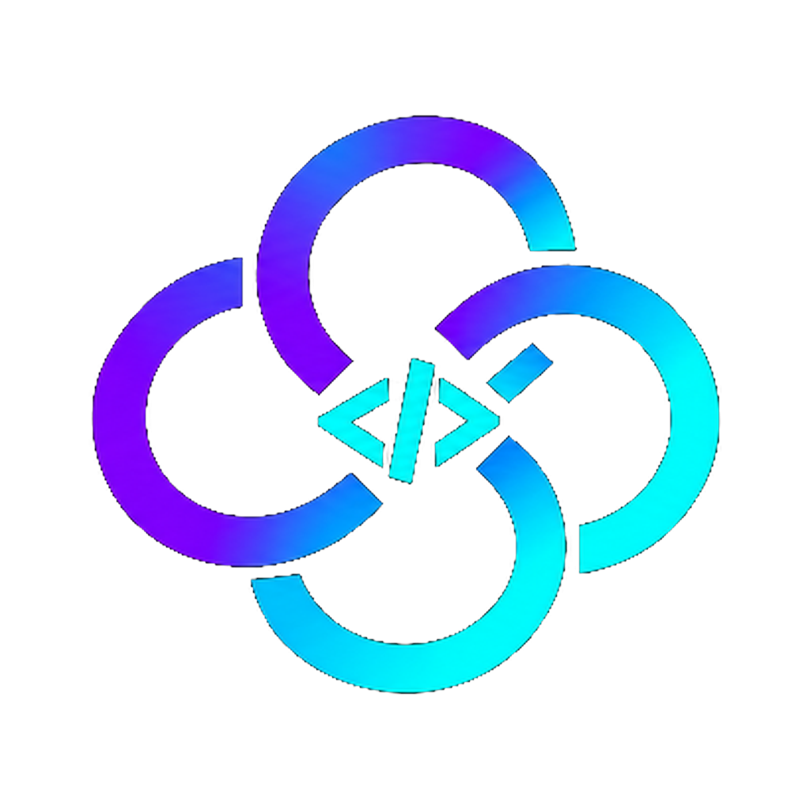

> **Decode Launcher:** central oficial da suíte de aplicativos criativos Decode. Uma solução moderna em Rust para instalar, gerenciar e atualizar ferramentas de código aberto com alto desempenho, segurança e respeito à privacidade.

<p align="center">
  <a href="https://kaiqueaurelio.github.io/decode-open-source-hub/">
    <picture>
      <source media="(prefers-color-scheme: dark)" srcset="docs/brand/decode-logo-white.svg">
      
    </picture>
  </a>
</p>

<p align="center">
  
</p>

<h1 align="center">Decode Launcher</h1>

<p align="center">
  <b>Um único lugar para instalar, atualizar e abrir todos os aplicativos da Decode App Suite, construído em puro Rust.</b><br>
  DecodePhoto, DecodeLight, DecodeFilm, DecodeDesign, DecodeVector, DecodePdf, DecodeEffect, DecodeWord,<br>
  DecodeDeck, DecodeGrid, DecodeCAD, DecodeSound e DecodeFig: a versão ideal para seu computador, sempre atualizada.
</p>

<p align="center">
  
  
  
  
</p>

<p align="center">
  <a href="https://github.com/Kaiqueaurelio/decode-open-source-hub/releases/latest"><b>Baixar Decode Launcher</b></a> ·
  <a href="https://kaiqueaurelio.github.io/decode-open-source-hub/">Decode Hub</a>
</p>

> [!NOTE]
> **A Decode é uma comunidade de criadores, artistas e desenvolvedores.** Pintores, fotógrafos,
> cineastas, ilustradores, designers, animadores, entusiastas e qualquer pessoa apaixonada por criação.
> Se você cria, você faz parte. **[Venha conversar no Discord](https://discord.gg/artcraft).**

<p align="center">
  <a href="#o-que-ele-faz">O que ele faz</a> ·
  <a href="#recursos">Recursos</a> ·
  <a href="#downloads">Downloads</a> ·
  <a href="#compilar-a-partir-do-código-fonte">Compilar do código-fonte</a> ·
  <a href="#a-suíte-de-aplicativos-decode">Decode App Suite</a> ·
  <a href="https://discord.gg/artcraft">Discord</a>
</p>

## O que ele faz

> Capturas de tela da versão oficial Decode serão adicionadas conforme novas compilações visuais forem publicadas.

Os aplicativos da Decode disponibilizam pacotes próprios para cada plataforma. O Decode Launcher poupa você de procurar em diversas páginas de lançamento: ele cataloga todos os aplicativos da suíte, identifica quais você já possui instalados e em quais versões, baixa a versão adequada para seu sistema operacional e arquitetura de processador, e notifica quando uma nova atualização for lançada. Trata-se de um aplicativo nativo e veloz que pode permanecer na sua barra de menus ou na bandeja do sistema.

## Recursos

<table>
  <tr>
    <td width="33%" valign="top">
      <h3>📦 Instalação em um clique</h3>
      Seleciona o download correto para seu sistema e processador (DMG, MSI, AppImage, .deb, .rpm e outros), valida a integridade com os hashes SHA-256 oficiais da release e executa a instalação.
    </td>
    <td width="33%" valign="top">
      <h3>🔄 Mantenha-se atualizado</h3>
      Verifica lançamentos e atualiza os aplicativos instalados. Uma notificação avisa sempre que houver novidades prontas para instalar.
    </td>
    <td width="33%" valign="top">
      <h3>🧭 Sempre à mão</h3>
      Abre qualquer aplicativo Decode a partir de uma única janela ou pelo ícone da bandeja. Interface nativa em egui, sem Electron, sem wrappers pesados.
    </td>
  </tr>
</table>

A versão web apresenta o mesmo catálogo diretamente no navegador, indicando o download mais recente para cada aplicativo.

## Idiomas da interface

A interface possui suporte para Português do Brasil (Português (Brasil)), Inglês (English), Tcheco (Čeština), Francês (Français), Alemão (Deutsch), Húngaro (Magyar), Japonês (日本語), Polonês (Polski), Russo (Русский), Chinês Simplificado (简体中文) e Espanhol (Español). **Automático**, a opção padrão, detecta o idioma do sistema ou navegador; **Configurações → Idioma** permite alternar a qualquer momento, preservando sua escolha entre inicializações. Localidades em português (`pt-BR`, `pt-PT`…) ativam o Português do Brasil. Para testar um idioma temporariamente sem alterar as configurações salvas, inicie o aplicativo desktop com a variável `DECODE_LAUNCHER_LOCALE=pt-BR` ou adicione `?lang=pt-BR` ao endereço na versão web.

Tipografias CJK utilizam as fontes instaladas no sistema operacional (Hiragino Sans ou PingFang no macOS, Yu Gothic ou Microsoft YaHei no Windows, Noto Sans CJK no Linux e FreeBSD). Textos sem tradução contam com fallback gracioso.

## Onde os aplicativos são instalados

O Decode Launcher instala cada aplicativo nos diretórios padrão do seu sistema operacional, utilizando pacotes oficiais para garantir compatibilidade total (e reconhece aplicativos que você já tenha instalado manualmente):

| Sistema | Localização | Método |
|---|---|---|
| macOS | `/Applications/<App>.app` | Extraído a partir do DMG oficial assinado e notarizado |
| Windows | `C:\Program Files\<App>` | Pacote MSI oficial via Windows Installer (com menu Iniciar e entradas do sistema) |
| Linux | `/usr/bin`, `/usr/share/applications` | Pacotes oficiais `.deb` (apt) ou `.rpm` (dnf, zypper) com diálogo de privilégios. Na ausência desses, Flatpak ou AppImage em `~/Applications` |
| Linux, em sandbox Flatpak do launcher | `~/.var/app/com.decode.launcher/data/decode-launcher/apps/<app>` | Arquivo tarball da release, descompactado na pasta do launcher e executado no sandbox |
| FreeBSD | `/usr/local` | Árvore oficial de arquivos com polkit (`~/.local` caso polkit não esteja disponível) |

O Decode Launcher também mantém a si mesmo atualizado: ao surgir uma nova versão, a ação **Atualizar e reiniciar** efetua o download, confere a assinatura/hash e reinstala o binário em execução de maneira transparente.

Atualizações respeitam o formato pelo qual o aplicativo foi originalmente instalado. Todos os downloads são verificados contra o hash SHA-256 antes da instalação, e um aplicativo em uso nunca é sobrescrito enquanto estiver aberto.

Registros de log são gravados em `logs/decode-launcher.log` na pasta de dados do usuário (`~/.local/share/decode-launcher` no Linux, `~/Library/Application Support/Decode Launcher` no macOS e `%LOCALAPPDATA%\Decode Launcher` no Windows).

## 📥 Downloads Oficiais do Decode Launcher (v0.9.0)

| Sistema Operacional | Formato | Link de Download Direto | Descrição |
| :--- | :--- | :--- | :--- |
| **🪟 Windows (Instalador)** | `.exe` | [**Baixar decode-launcher.exe**](https://github.com/Kaiqueaurelio/decode-open-source-hub/releases/download/v0.9.0/decode-launcher.exe) | Instalador direto para Windows 10 e 11 x64 |
| **🪟 Windows (Portátil)** | `.zip` | [**Baixar decode-launcher-windows-x64.zip**](https://github.com/Kaiqueaurelio/decode-open-source-hub/releases/download/v0.9.0/decode-launcher-windows-x64.zip) | Arquivo portátil ZIP (extrair e rodar sem instalar) |
| **🐧 Linux (x86_64)** | `.tar.gz` | [**Baixar decode-launcher-linux-x86_64.tar.gz**](https://github.com/Kaiqueaurelio/decode-open-source-hub/releases/download/v0.9.0/decode-launcher-linux-x86_64.tar.gz) | Binário executável independente com ícones e atalhos |
| **🍎 macOS** | `.tar.gz` | [**Baixar decode-launcher-macos.tar.gz**](https://github.com/Kaiqueaurelio/decode-open-source-hub/releases/download/v0.9.0/decode-launcher-macos.tar.gz) | Pacote universal macOS |

> 📌 **Ver todas as releases e códigos-fonte:** [GitHub Releases](https://github.com/Kaiqueaurelio/decode-open-source-hub/releases)

---

## Downloads

Baixe a versão correspondente ao seu sistema a partir da [última versão (latest release)](https://github.com/Kaiqueaurelio/decode-open-source-hub/releases/latest) ou navegue por [todas as releases](https://github.com/Kaiqueaurelio/decode-open-source-hub/releases). Cada publicação fornece um arquivo `SHA256SUMS.txt` para conferência de integridade.

**Windows** (10 e 11)

| Arquivo | Descrição |
|---|---|
| `decode-launcher-<ver>-windows-x64.msi` | Instalador para PCs modernos (Intel e AMD 64 bits). Instalação por usuário, sem necessidade de privilégios de administrador |
| `decode-launcher-<ver>-windows-arm64.msi` | Instalador para Windows em arquitetura Arm (Snapdragon e dispositivos compatíveis) |
| `decode-launcher-<ver>-windows-x86.msi` | Instalador para ambientes Windows 32 bits |
| `decode-launcher-<ver>-windows-{x64,arm64,x86}-portable.zip` | Versão portátil sem instalação: descompacte e execute `decode-launcher.exe`. Configurações salvas localmente na pasta |

**macOS** (11 Big Sur ou superior)

| Arquivo | Descrição |
|---|---|
| `decode-launcher-<ver>-macos-universal.dmg` | Aplicativo universal para Apple Silicon (M1/M2/M3/M4) e processadores Intel. Basta arrastar para a pasta Aplicativos |

**Linux** (x86_64 e aarch64; glibc 2.35 ou mais recente, ex.: Ubuntu 22.04+, Debian 12+, Fedora 36+)

| Arquivo | Descrição |
|---|---|
| `decode-launcher-<ver>-linux-{x86_64,aarch64}.AppImage` | Executável independente que roda em praticamente qualquer distribuição; basta dar permissão de execução (`chmod +x`) e abrir |
| `decode-launcher-<ver>-linux-{x86_64,aarch64}.deb` | Debian, Ubuntu, Linux Mint, Pop!_OS: `sudo apt install ./decode-launcher-…deb` |
| `decode-launcher-<ver>-linux-{x86_64,aarch64}.rpm` | Fedora, openSUSE, RHEL: `sudo dnf install ./decode-launcher-…rpm` |
| `decode-launcher-<ver>-linux-{x86_64,aarch64}.flatpak` | Pacote Flatpak pronto: `flatpak install --user decode-launcher-…flatpak` |
| `decode-launcher-<ver>-linux-{x86_64,aarch64}.tar.gz` | Árvore binária descompactável (`bin/`, `share/`) para outros sistemas e automações |

Compilações para RISC-V (riscv64) são fornecidas como `decode-launcher-<ver>-linux-riscv64.{deb,rpm,tar.gz}`.

O ícone da área de notificação utiliza o padrão StatusNotifierItem (KDE, Xfce, Cinnamon; no GNOME instale a extensão AppIndicator).

**FreeBSD** (14, x86_64)

| Arquivo | Descrição |
|---|---|
| `decode-launcher-<ver>-freebsd-x86_64.tar.gz` | Estrutura organizada para instalação em `/usr/local` |

```sh
pkg install libxkbcommon wayland libX11 libXcursor libXrandr libXi libxcb mesa-libs vulkan-loader fontconfig freetype2
tar -xzf decode-launcher-<ver>-freebsd-x86_64.tar.gz --strip-components 1 -C /usr/local
decode-launcher
```

**Web (WebAssembly)**

| Arquivo | Descrição |
|---|---|
| `decode-launcher-web-<ver>.zip` | Catálogo em formato de site estático para hospedagem em qualquer servidor; consulte [`packaging/web/README.md`](packaging/web/README.md) |

## Compilar a partir do código-fonte

Requer uma versão estável recente do Rust (1.90 ou superior). No Linux, instale os pacotes de cabeçalho do sistema de janelas:
```sh
sudo apt install libxkbcommon-dev libwayland-dev libx11-dev libxrandr-dev libxi-dev libgl1-mesa-dev
```

Para clonar e compilar:
```sh
git clone https://github.com/Kaiqueaurelio/decode-open-source-hub.git
cd decode-open-source-hub/launcher
cargo run --release -p decode-launcher   # executa a aplicação desktop
cargo xtask ci                           # formatação, clippy, testes e verificação wasm
```

A versão WebAssembly compila utilizando [trunk](https://trunk-rs.github.io/trunk/):
```sh
rustup target add wasm32-unknown-unknown
cd apps/decode-launcher-web && trunk serve
```

### Nix (experimental)

O arquivo `flake.nix` fornece um ambiente de desenvolvimento (`nix develop`) e pacote:
```sh
nix run github:Kaiqueaurelio/decode-open-source-hub#launcher
```

### Instalação de compilações próprias

Para instalar e atualizar os aplicativos a partir de repositórios clonados localmente na sua máquina em vez do GitHub, utilize as ferramentas de espelhamento local do xtask:

```sh
cargo xtask local sync      # sincroniza e empacota cada aplicativo para ../local-mirror
cargo xtask local serve     # serve as compilações e feed de releases em http://127.0.0.1:8787/
DECODE_LAUNCHER_DOWNLOAD_BASE=http://127.0.0.1:8787/ cargo run --release -p decode-launcher --features local-mirror
```

Instruções para novos contribuidores e agentes de IA estão descritas em [`AGENTS.md`](AGENTS.md). Scripts de empacotamento ficam em [`packaging/`](packaging/).

> [!IMPORTANT]
> **Status:** O Decode Launcher está em fase alpha inicial. Caso encontre comportamentos inesperados, por favor abra uma issue no repositório (informando seu sistema operacional, o aplicativo que tentava instalar e o arquivo de log do launcher) ou entre em contato pelo [Discord](https://discord.gg/artcraft).

## A Suíte de Aplicativos Decode

O Decode Launcher gerencia a **Decode App Suite**: ferramentas criativas livres e de código aberto, desenvolvidas em Rust com alto desempenho e autonomia:

| | Aplicativo | Finalidade | Código-fonte | Saiba mais |
|:-:|---|---|---|---|
|  | **DecodePhoto** | Edição de imagens: camadas, máscaras, texto e suporte real a PSD | [GitHub](https://github.com/Kaiqueaurelio/decode-open-source-hub/tree/main/apps/photocraft) | [Site](https://decode-open-source-hub.vercel.app/#photocraft) |
|  | **DecodeVector** | Ilustração vetorial profissional | [GitHub](https://github.com/Kaiqueaurelio/decode-open-source-hub/tree/main/apps/vectorcraft) | [Site](https://decode-open-source-hub.vercel.app/#vectorcraft) |
|  | **DecodeFilm** | Edição de vídeo, pós-produção, cor e áudio | [GitHub](https://github.com/Kaiqueaurelio/decode-open-source-hub/tree/main/apps/filmcraft) | [Site](https://decode-open-source-hub.vercel.app/#filmcraft) |
|  | **DecodeLight** | Revelação RAW e catálogo de fotografias | [GitHub](https://github.com/Kaiqueaurelio/decode-open-source-hub/tree/main/apps/lightcraft) | [Site](https://decode-open-source-hub.vercel.app/#lightcraft) |
|  | **DecodePdf** | Leitura, anotação, organização e segurança em PDFs | [GitHub](https://github.com/Kaiqueaurelio/decode-open-source-hub/tree/main/apps/pdfcraft) | [Site](https://decode-open-source-hub.vercel.app/#pdfcraft) |
|  | **DecodeEffect** | Motion graphics e efeitos visuais | [GitHub](https://github.com/Kaiqueaurelio/decode-open-source-hub/tree/main/apps/effectcraft) | [Site](https://decode-open-source-hub.vercel.app/#effectcraft) |
|  | **DecodeDesign** | Diagramação, editoração de páginas e publicação | [GitHub](https://github.com/Kaiqueaurelio/decode-open-source-hub/tree/main/apps/designcraft) | [Site](https://decode-open-source-hub.vercel.app/#designcraft) |
|  | **DecodeFig** | Design de interfaces de usuário e prototipagem interativa | [GitHub](https://github.com/Kaiqueaurelio/decode-open-source-hub/tree/main/apps/figcraft) | [Site](https://decode-open-source-hub.vercel.app/#figcraft) |
|  | **DecodeWord** | Processamento de texto e formatação de documentos | [GitHub](https://github.com/Kaiqueaurelio/decode-open-source-hub/tree/main/apps/wordcraft) | [Site](https://decode-open-source-hub.vercel.app/#wordcraft) |
|  | **DecodeSound** | Gravação, mixagem e edição de áudio multipista | [GitHub](https://github.com/Kaiqueaurelio/decode-open-source-hub/tree/main/apps/soundcraft) | [Site](https://decode-open-source-hub.vercel.app/#soundcraft) |
|  | **DecodeDeck** | Apresentações e slides visuais | [GitHub](https://github.com/Kaiqueaurelio/decode-open-source-hub/tree/main/apps/deckcraft) | [Site](https://decode-open-source-hub.vercel.app/#deckcraft) |
|  | **DecodeCAD** | Projeto e desenho técnico assistido por computador (CAD) | [GitHub](https://github.com/Kaiqueaurelio/decodecad) | [Site](https://decode-open-source-hub.vercel.app/#cadcraft) |
|  | **DecodeGrid** | Planilhas eletrônicas e processamento de dados | [GitHub](https://github.com/Kaiqueaurelio/decode-open-source-hub/tree/main/apps/gridcraft) | [Site](https://decode-open-source-hub.vercel.app/#gridcraft) |

<br>

<p align="center">
  <a href="https://discord.gg/artcraft"></a>
</p>

<h3 align="center">Venha criar conosco</h3>

<p align="center">
  Nosso Discord é o ponto de encontro de criadores de todas as áreas: artistas digitais, fotógrafos,
  animadores, designers, desenvolvedores e iniciantes. Compartilhe o que está produzindo, peça ajuda,
  sugira melhorias ou reporte problemas. Você é muito bem-vindo!
</p>

<p align="center">
  <a href="https://discord.gg/artcraft"><b>discord.gg/artcraft</b></a> ·
  <a href="https://kaiqueaurelio.github.io/decode-open-source-hub/">Decode Hub</a> ·
  <a href="https://github.com/Kaiqueaurelio/decode-open-source-hub/tree/main/launcher">Código do Decode Launcher</a>
</p>

---

## Agradecimentos

A comunidade desenvolveu soluções para o ecossistema antes de nós, e o Decode Launcher aprendeu muito com elas. Agradecemos aos seus autores:

| Projeto | Autor | Contribuição e aprendizado |
|---|---|---|
| [Decode Suite Updater](https://github.com/Lyraedan/Decode-Suit-Updater) | [@Lyraedan](https://github.com/Lyraedan) | Detecção de aplicativos instalados ou removidos externamente via varredura em segundo plano, suporte a Arch/AUR via pacman e seletor por sistema operacional |
| [craftcenter](https://github.com/avokadosauce/craftcenter) | [@avokadosauce](https://github.com/avokadosauce) | Descoberta da versão mais recente sem gastar cota da API (redirecionamento de `releases/latest` + `SHA256SUMS.txt`) e validação de arquivos |
| [CRAFTSPACE](https://github.com/emircesur/CRAFTSPACE) | [@emircesur](https://github.com/emircesur) | Reconhecimento de aplicativos preexistentes, fallback elegante para limite de taxa do GitHub e notificações de atualização |
| [GetCraft](https://github.com/mbirnbach/getcraft) | [@mbirnbach](https://github.com/mbirnbach) | Seleção do binário exato por SO e arquitetura, detecção de pacotes no Windows Installer e macOS, launcher nativo em Rust/egui |
| [CraftHub](https://github.com/CraftHubLauncher/CraftHub) | [CraftHubLauncher](https://github.com/CraftHubLauncher) | Verificações estritas de integridade de downloads, mensagens claras de cota e proteção contra substituição de aplicativo em execução |
| [artcraft-suite](https://github.com/erikerikerik/artcraft-suite) | [@erikerikerik](https://github.com/erikerikerik) | Verificação de releases com cache ETag e recuperação limpa contra interrupções de download |
| [Decode Apps Launcher & Installer](https://github.com/ZifuM/Craft-apps-launcher-installer) | [@ZifuM](https://github.com/ZifuM) | Fallbacks de páginas de release e inicialização limpa de AppImages |
| [Decode Launcher](https://github.com/EricVogt93/decode-launcher) | [@EricVogt93](https://github.com/EricVogt93) | Integração de AppImages ao desktop e mecanismo seguro de auto-atualização |
| [LandingCraft](https://github.com/rallegretti/LandingCraft) | [@rallegretti](https://github.com/rallegretti) | Interação direta com o Windows Installer e oferta de versões estáveis |
| [Decode Apps Manager](https://github.com/CryptoKey98/craft-apps-manager) | [@CryptoKey98](https://github.com/CryptoKey98) | Verificações periódicas agendadas em segundo plano e opções por aplicativo |
| [Decode Hub Launcher](https://github.com/tinyplayerss/artcraft-hub-launcher) | [@tinyplayerss](https://github.com/tinyplayerss) | Central visual única e acolhedora para toda a suíte |
| [CraftHub](https://github.com/MegaTheLEGEND/CraftHub) | [@MegaTheLEGEND](https://github.com/MegaTheLEGEND) | Execução de compilações web dos aplicativos a partir de servidor local |

## Licença e créditos

O Decode Launcher possui licença dupla sob [MIT](LICENSE-MIT) ou [Apache-2.0](LICENSE-APACHE), à sua escolha.
Copyright (c) 2026 Decode Team e colaboradores do Decode Launcher. Os avisos legais obrigatórios estão preservados em [NOTICE](NOTICE).

Fontes, ícones e ativos empacotados mantêm suas licenças de código aberto correspondentes; cada um está devidamente catalogado com autor, fonte e licença em [ATTRIBUTION.md](ATTRIBUTION.md).

Os ícones dos aplicativos (`assets/app-icons/`) são os ícones originais de cada software, incluídos a partir de seus respectivos repositórios e sob as licenças dos projetos correspondentes (MIT OR Apache-2.0).

Os ativos de marca e identidade visual Decode estão protegidos sob suas diretrizes em [`docs/brand/`](docs/brand/).

<p align="center">
  <a href="https://kaiqueaurelio.github.io/decode-open-source-hub/"></a><br>
  <sub>Desenvolvido pela equipe e comunidade <a href="https://kaiqueaurelio.github.io/decode-open-source-hub/">Decode</a>.</sub>
</p>
